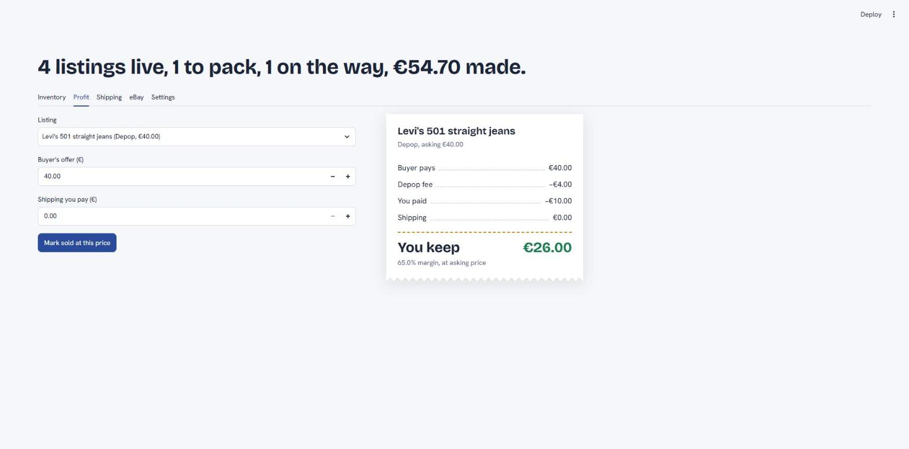

# Logistics Tracker

Small Streamlit app for reselling clothes: log listings, check the net profit of an offer, and track shipping labels. Data lives in a local SQLite file.



## Download (Windows)

1. Get `LogisticsTracker.exe` from the repository's **Releases** page.
2. Double-click it. The app opens in its own window after a few seconds. Closing the window stops it.

Good to know:

- Windows may show "Windows protected your PC" because the file is not signed. Choose **More info > Run anyway**.
- It needs Microsoft Edge or Google Chrome installed; the window is drawn by one of them.
- Your data is kept in `%APPDATA%\LogisticsTracker\tracker.db`, so replacing the exe with a newer one keeps it.

## Run from source

```
python -m venv .venv
.venv\Scripts\pip install -r requirements.txt
.venv\Scripts\streamlit run app.py
```

`tracker.db` is created on first run from `schema.sql`.

To build the exe yourself: `powershell -ExecutionPolicy Bypass -File build.ps1`. The result is `dist\LogisticsTracker.exe`.

## Layout

| File | What it does |
|---|---|
| `app.py` | Streamlit UI: Inventory, Profit and Shipping tabs |
| `db.py` | SQLite connection and queries |
| `finance.py` | Net profit and margin calculation |
| `launcher.py` | Start-up of the exe: runs the app and opens its window |
| `build.ps1` | Builds the exe with PyInstaller |
| `ship24.py` | Tracking lookup through the Ship24 API |
| `ebay.py` | eBay sign-in, active listings, Best Offers and orders |
| `vault.py` | Encrypts saved keys with Windows DPAPI |
| `schema.sql` | Tables and starting platform fees |
| `.streamlit/config.toml` | Colours and fonts |
| `style.css` | Look of the profit receipt and the parcel progress bar |
| `scripts/live_check.py` | Runs the real Ship24 and eBay calls once, to check the parsing |
| `tests/` | Unit tests (the API tests use fake responses) |

## Flow

1. Add a listing in **Inventory**.
2. In **Profit**, enter the buyer's offer and the shipping you pay. The receipt shows the platform fee, taken from the listing's platform, and what you keep.
3. **Mark sold** moves the listing out of the active list and opens a shipment.
4. Update the shipment's status, carrier and tracking number in **Shipping**.

The seeded platform fees are only starting values. Set your real ones under **Inventory > Platform fees**.

## Connecting your accounts

Everyone uses their own keys. They are typed into the **Settings** tab and saved in `tracker.db` on your computer. Never put a key in the code.

How the app protects them:

- On Windows the saved keys are encrypted with your Windows account (DPAPI). A copy of `tracker.db` on another PC or account cannot read them. On other systems they are plain text.
- Saved keys are never shown again in the page. To change one, type a new one.
- The app only answers to this computer (`127.0.0.1`) and ignores requests that reach it through another site's domain.

Still keep `tracker.db` to yourself: your listings in it are not encrypted, and a program running under your own Windows account can decrypt the keys.

### Ship24 (tracking)

1. Create an account at ship24.com and copy your API key.
2. Paste it in **Settings** and save.
3. In **Shipping**, give a shipment a tracking number, then press **Refresh tracking**. The status and the latest event are saved; the full event list is shown below.

Each press is one request to Ship24 and counts against your plan.

### eBay

1. Join the eBay Developers Program (free) at developer.ebay.com and create a **Production** keyset.
2. Under **User Tokens > Get a Token from eBay via Your Application**, add an eBay Redirect URL. Set "Your auth accepted URL" to any https page and tick OAuth. The name it gives you is the RuName.
3. Paste the App ID, Cert ID and RuName in **Settings** and save.
4. Press **Sign in to eBay and agree**. Copy the full address of the page you land on (it contains `code=`), paste it back within 5 minutes and press **Connect**.
5. The **eBay** tab now loads your active listings, Best Offers and recent orders. It is read-only: nothing is changed on eBay.

The sign-in lasts about 18 months, then step 4 is needed again.

Vinted and Depop have no API open to the public, so those listings are entered by hand.

## Data

- Money is stored as whole cents (`INTEGER`) and fee rates as basis points (12.8% = 1280), so no amount goes through floating point. Fees round half up to the cent.
- Every tracking event Ship24 reports is saved in `shipment_events`, so a parcel's history survives a restart. Checking again only adds events not seen before.
- A database from v0.1 (euros stored as `REAL`) is converted on first start, all or nothing. The old file is kept next to it as `tracker.before-cents.db`.

## Checking against the real APIs

The unit tests use fake responses. To check the parsing against the real services, save your keys in the app first, then:

```
.venv\Scripts\python scripts\live_check.py ship24 <tracking number>
.venv\Scripts\python scripts\live_check.py ebay
```

It prints the shape of the raw reply (field names and types only) and what the app made of it. Keys are never printed. Add `--exe` to use the keys saved by the exe.

## Tests

```
.venv\Scripts\python -m unittest discover tests
```
